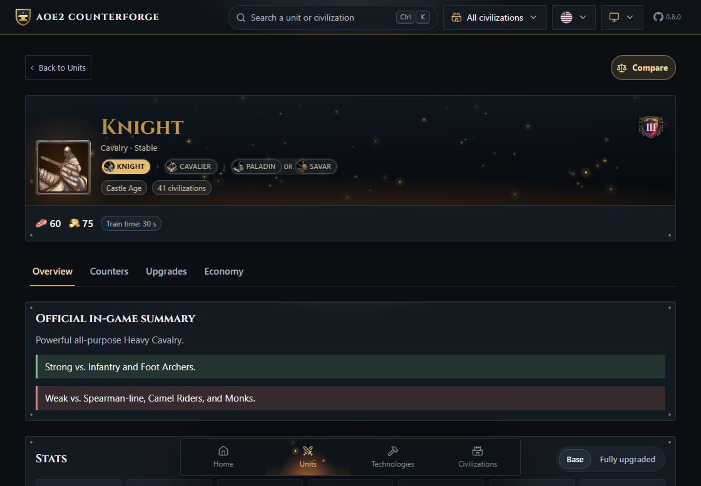
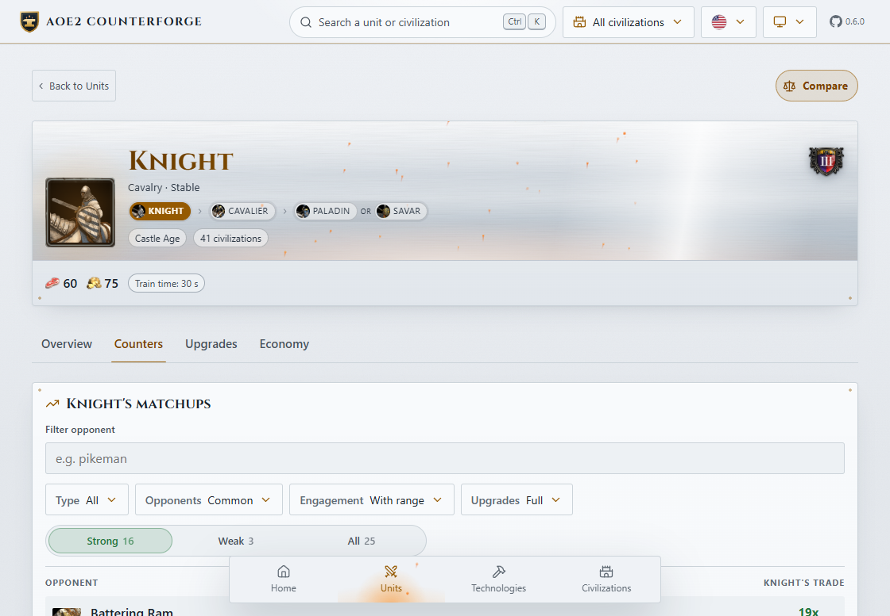
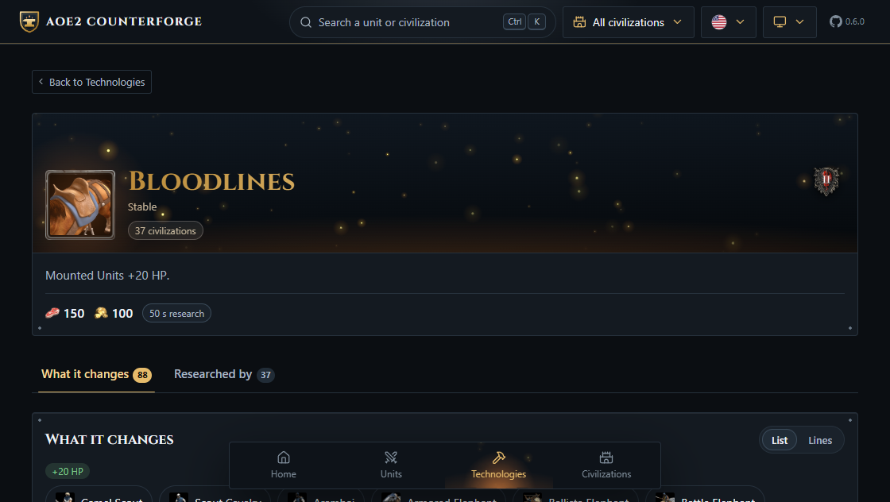
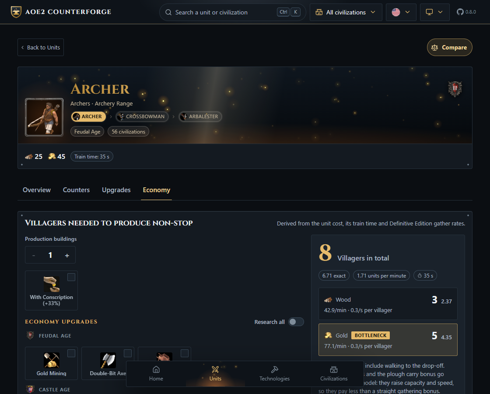
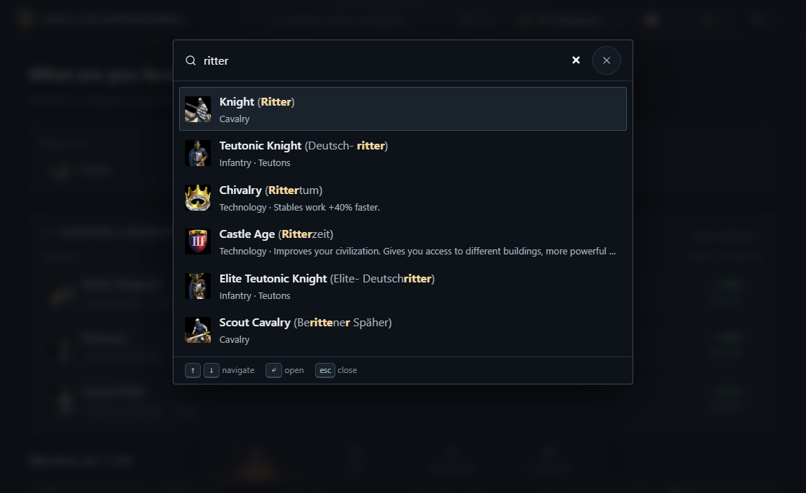

<p align="center">
  
</p>

<h1 align="center">AoE2 Counterforge</h1>

<p align="center">
  <strong>A unit guide for Age of Empires II: Definitive Edition.</strong><br>
  What beats it, what it costs, which upgrades touch it, and how many villagers keep it coming.
</p>

<p align="center">
  <a href="https://github.com/aoe2-counterforge/aoe2-counterforge.github.io/actions/workflows/ci.yml"></a>
  
  &nbsp;·&nbsp;
  
  
  
  
</p>

<p align="center">
  <a href="https://aoe2-counterforge.github.io/en/"><strong>Open the guide →</strong></a>
</p>

<p align="center">
  
</p>

---

Pick a unit and get an answer, not a wiki page. The counters are **computed from the game's own
damage formula** every time you open them, so they follow the civilization you picked, the upgrades
you have, and whether you plan to stand and fight or shoot on the move.

## ✨ A tour of the guide

### Counters worked out, not written down



A unit's **Counters** tab runs every matchup through the damage formula: attack against armour for
each shared class, damage per hit, damage per second, how long each side stands in the other's range,
and whether a shooter can kite. Each fight is then weighed by what both sides cost, so a favourable
trade means you come out ahead on resources, not just that your unit is left standing.

The strong matchups, the weak ones and every opponent sit behind one switch.

### Every technology, and what it actually does



Each technology has a page of its own with its cost, its research time, every unit it changes and by how
much, and the civilizations that get to research it. The effects come from the game's effect table
rather than the in-game tooltip, so a technology that does more than its text admits shows all of it.

The same data runs the **Upgrades** tab of each unit, which lists every technology that touches it and
the total once everything is researched.

### How many villagers keep it coming



The **Economy** tab answers the question every build order runs into: how many villagers on each
resource keep this building producing without a pause. It starts from the unit's cost, its training
time and the game's gather rates, and calls out the resource that holds production back.

Every trip also includes the walk back to the drop-off. How far that is depends on how each match is
played, on where the mill, the lumber camp or the mining camp goes up, so the guide assumes a typical
layout: **2 tiles** from a farm, a sheep or a hunt, which is lured or pushed under the Town Center, and
**3** from trees, mines, berries and shore fish. [How the economy is calculated](docs/economy.md) shows where each of those
numbers enters the sum.

Add buildings, apply a bonus such as Conscription, or research the gathering upgrades age by age, and
the numbers follow.

### Find anything from anywhere



`Ctrl` + `K` (`Cmd` + `K` on a Mac) opens one search across units, civilizations and technologies,
ranked together, with the kind of each result on the line beneath it. It matches loosely, ignores
accents and understands all six languages at once: type the German *ritter* into the English guide
and the Knight, the Teutonic Knight and Chivalry come up, each with the German name it matched. The
keyboard alone takes you from the query to the page.

### And also

- 🏰 **Civilization-aware.** Pick a civilization and every stat, counter and ranking follows what it can research *and* the bonuses it is simply given.
- ⚖️ **Four units side by side**, best value crowned on every row, plus who beats whom as duels, standings or a matrix.
- 🌐 **A real page for every unit, technology and civilization** in English, Portuguese, Spanish, Italian, German and French, written ahead of time so it reads without JavaScript and can be found from a search.
- 📴 **Works offline.** The whole dataset ships with the page; nothing is fetched at runtime.

## 🚀 Run it locally

```sh
npm install
npm run dev
```

Then open <http://localhost:5173/>. No game install, no API key, no network — the data is in
the repository.

Every drop-down is driven by [select-box](https://github.com/giovani-freitag/select-box), which is not on npm
yet. Its packages are vendored as tarballs under `vendor/select-box/`, packed from the `v0.1.0` tag with
`pnpm pack`, and `npm install` picks them up from there.

`npm run build` writes a page for every address into `dist/`, for the address in `homepage`. To publish
somewhere else, set `SITE_URL` to the full address first, such as `SITE_URL=https://example.com/ npm run build`.

`npm test` runs the unit and feature tests. `npm run test:e2e` drives the real pages in a browser, on a phone
and on a desktop, with [Playwright](https://playwright.dev). On Windows it uses the Edge the system ships with;
elsewhere run `npx playwright install chromium` once before. To run them in another Chromium-based browser,
such as Brave, point `PLAYWRIGHT_BROWSER` in `.env` at its executable, as `.env.example` shows.
`npm run docs:screenshots` retakes the pictures on this page.

## 📚 Docs

- **[How the counters are calculated](docs/counters.md)** — the formula, the assumptions and the limits.
- **[How the economy is calculated](docs/economy.md)** — gather rates as trips, and where each upgrade lands.
- **[Where the data comes from](docs/data.md)** — reading the game files, and how to regenerate.
- **[Architecture decisions](docs/adr/)** — the rules this codebase is held to.

---

MIT licensed. Age of Empires II, its data and its artwork belong to Microsoft, Forgotten Empires, Ensemble Studios
and SkyBox Labs. This is a fan project, unaffiliated and non-commercial. Interface icons by
[Lucide](https://lucide.dev) (ISC); Cinzel under the SIL Open Font License 1.1.
